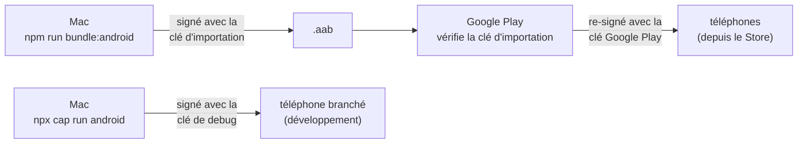

# Les clés de signature Android

Pourquoi une application Android a des clés, pourquoi CountRep en a trois, et pourquoi Google Cloud demande leurs
empreintes. Les valeurs et les commandes sont dans la [référence](../reference/android-signing.md).

## Ce que prouve une signature

Tout APK installé sur Android est **signé** : une clé privée signe le contenu, et le certificat qui va avec (la partie
publique) est joint à l'application. Android s'en sert pour une seule chose, mais essentielle : **une mise à jour
n'est acceptée que si elle est signée par le même certificat** que l'application installée. Sans ça, n'importe qui
pourrait publier un « CountRep » qui remplacerait le vrai et lirait ses données.

Le certificat ne dit donc pas « c'est sûr », mais « c'est le même auteur que la dernière fois ». Il n'est pas émis par
une autorité : on le crée soi-même (`keytool`), et il vaut pour toute la vie de l'application.

## Une clé par usage

- **La clé Google Play** (*app signing key*) signe l'application que les utilisateurs installent depuis le Store.
  Google l'a créée et la garde ; personne ne peut la perdre ni la voler sur le Mac. C'est le principe de **Play App
  Signing**, obligatoire pour un `.aab`.
- **La clé d'importation** (*upload key*) ne sert qu'à prouver à Google que l'`.aab` envoyé vient bien de l'auteur.
  Google vérifie cette signature, la retire, et signe avec sa clé. Si elle est perdue ou volée, Google la remplace sur
  demande : les téléphones ne voient jamais cette clé, rien ne change pour eux. C'est tout l'intérêt de la séparation :
  le seul secret gardé sur le Mac (et dans KeePass) est remplaçable.
- **La clé de debug** est créée automatiquement par le SDK Android sur chaque Mac, avec un mot de passe connu de tous
  (`android`). Elle signe les builds de développement, pour les installer sur un téléphone sans toucher aux vraies
  clés. Elle n'a aucune valeur de secret.

Conséquence pratique : une application installée depuis le Store (clé Google Play) et un build de développement (clé
de debug) sont, pour Android, **deux auteurs différents**. L'un ne peut pas remplacer l'autre sans désinstaller.

## Pourquoi Google Cloud veut les empreintes

Une **empreinte** (SHA-1, SHA-256) est un résumé court du certificat : publique, elle l'identifie sans rien révéler de
la clé privée.

La connexion Google native vérifie **quelle application** demande un jeton : Android lui donne le nom du package et le
certificat de l'application qui appelle. Google n'accepte que si ce couple correspond à un **client OAuth Android**
déclaré dans le projet Google Cloud `countrep`. Ainsi, une autre application qui prendrait le même nom de package ne
pourrait pas obtenir de jetons au nom de CountRep : elle n'a pas la clé.

D'où **un client Android par clé** : debug (pour le développement), importation (pour un build release installé à la
main), Google Play (pour l'application du Store). Celui qui manque le plus souvent est le dernier, parce que la clé est
chez Google et que tout marche en local : l'erreur `[28444] Developer console is not set up correctly` n'apparaît
qu'avec l'application du Store.

Le jeton obtenu, lui, a pour audience le **client Web** : c'est ce que vérifie l'API (`GOOGLE_CLIENT_IDS`). Les clients
Android ne servent qu'à autoriser l'application à le demander (ADR 0013).

## Ce qu'il faut retenir

| Clé | Secret ? | La perdre |
|---|---|---|
| Google Play | Chez Google | Impossible |
| Importation | Oui (Mac, KeePass) | Remplaçable par Google en quelques jours ; nouveau client OAuth à déclarer |
| Debug | Non | Une nouvelle est créée ; nouveau client OAuth si on veut la connexion Google en développement |
