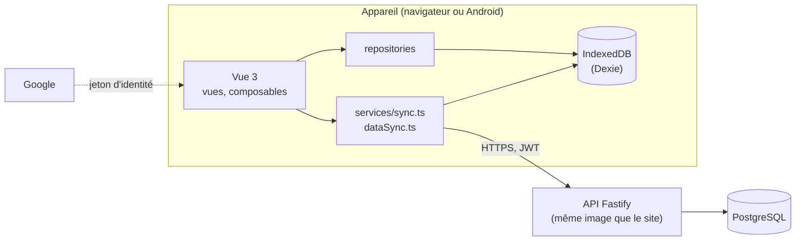

# Architecture

CountRep note des répétitions d'exercices au poids du corps ou à l'élastique. Le principe qui commande tout le
reste : **l'application marche sans réseau et sans compte** (ADR 0014). Le serveur n'est qu'un point de
synchronisation, pour retrouver ses données sur un autre appareil.

## Les deux paquets

| | `frontend/` | `backend/` |
|---|---|---|
| Techno | Vue 3, TypeScript, Vite, Pinia, Vue Router, Tailwind 4, Dexie, vue-i18n, Capacitor | Fastify 5, `pg` (SQL écrit à la main, sans ORM), `jsonwebtoken`, `google-auth-library` |
| Point d'entrée | `src/main.ts`, `src/App.vue`, `src/router/router.ts` | `src/server.ts` (importe d'abord `src/config.ts`) |
| Organisation | `views/`, `components/`, `composables/`, `repositories/`, `services/`, `api/`, `stores/`, `db.ts` | Un plugin Fastify par fichier dans `src/routes/`, `middleware/auth.ts` |

Pas de workspace npm : deux paquets indépendants, chacun son `package.json`. En production, une seule image : l'API sert
aussi le frontend construit (`@fastify/static`), sur la même origine (ADR 0017).

## Le vocabulaire (ADR 0006)

- **set** : une saisie, un exercice, N répétitions (ou secondes), à une date et une heure. UI : « saisie ».
- **workout** : un modèle de séance, des exercices ordonnés avec leurs objectifs, répétés `rounds` fois. UI : « séance ».
- **round** : un passage par tous les exercices d'une séance. UI : « série ».
- **preview** : la séance en cours, un brouillon local jusqu'à son enregistrement.

Un exercice a une **unité** (ADR 0008) : `reps` ou `seconds`. Pour un exercice en secondes, le champ `reps` contient
des secondes ; on n'additionne jamais les deux.

## Hors ligne d'abord : la synchronisation

IndexedDB est la source de vérité de l'interface ; chaque écriture se fait d'abord là.

1. Une saisie créée, modifiée ou supprimée est marquée `pending`, avec son opération (`create`, `update`, `delete`).
   La suppression est logique (`deletedAt`) jusqu'à la confirmation du serveur.
2. La synchronisation (au démarrage et au retour du réseau) **pousse** les `pending`, puis **tire**
   tout du serveur. Le tirage n'écrase jamais une écriture locale en attente, et retire les saisies synchronisées que
   le serveur n'a plus.
3. Les identifiants sont des UUID créés par l'appareil ; le `POST` du serveur est un *upsert* : rejouer une création
   est sans danger (ADR 0002).

Les modèles de séance et la sélection d'exercices suivent le même principe (`services/dataSync.ts`). Le catalogue des
exercices est embarqué (`src/data/exercises.json`) pour marcher sans API.

Une séance en cours est un brouillon (`previews`) ; à l'enregistrement, ses entrées deviennent des saisies qui portent
l'identifiant et le nom de la séance (ADR 0007, 0011).

## Connexion et comptes

- **Google seulement** (ADR 0013) : l'application obtient un jeton d'identité Google (popup sur le web, natif sur
  Android) et l'échange contre un JWT de 7 jours (`POST /api/auth/google`), renouvelé en glissant (ADR 0003). Le compte
  est identifié par le `sub` Google ; pas d'e-mail stocké.
- **Sans compte**, aucun appel à l'API. À la première connexion, les données locales sont adoptées par le compte et
  envoyées ; les données d'un autre compte sont effacées de l'appareil, avec confirmation (ADR 0014).
- Un 401 ne perd rien : le token est retiré, l'application continue en local et invite à se reconnecter.
- **Supprimer son compte** (ADR 0016) supprime tout côté serveur (`ON DELETE CASCADE`) et sur l'appareil.

Côté API, chaque route protégée vérifie le JWT et l'existence de l'utilisateur, et chaque requête SQL filtre par
`user_id`.

## Interface

- Écrans : aujourd'hui (calendrier, sélection d'exercice, saisie), journal, statistiques, profil et réglages.
- Thème clair ou sombre par des variables CSS (ADR 0010) : jamais de couleur en dur.
- Français et anglais (ADR 0009) : jamais de texte en dur, `t()` et `src/i18n/fr.ts`, `en.ts`.

## Livraison

- **Web** : une image `countrep` et une image de migration Flyway `countrep-migrations`, publiées par la CI pour un tag
  `web-vX.Y.Z`, déployées sur le VPS. Le site est une PWA, mise à jour quand l'utilisateur l'accepte (ADR 0015).
- **Android** : le même frontend dans Capacitor (ADR 0012), publié sur Google Play, qui appelle l'API de production.

Voir [Versions et livraisons](versions-and-releases.md).

## Pour aller plus loin

Les ADR (`docs/adr/`) donnent le pourquoi de chaque choix ; `CLAUDE.md` à la racine résume les règles à respecter en
modifiant le code (contraintes de la base, fichiers à garder synchronisés).
