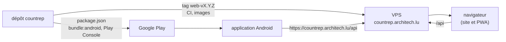

# Versions et livraisons

CountRep arrive aux utilisateurs par **deux chemins**, qui ne vont pas à la même vitesse.

| | Version web | Application Android |
|---|---|---|
| Contenu | Image `countrep` (API **et** frontend) et image `countrep-migrations` | Le frontend, embarqué avec Capacitor |
| Numéro | Tag git `web-vX.Y.Z` | `version` de `frontend/package.json`, puis tag git `android-vX.Y.Z` |
| Construit par | La CI | Le Mac (il a la clé d'importation) |
| Arrive chez l'utilisateur | Au déploiement, puis quand il accepte l'invite de mise à jour de la PWA | Après l'examen de Google, puis la mise à jour du Store (des jours, parfois jamais) |
| Retour en arrière | `deploy-app` de la version précédente | Impossible : une nouvelle version |

Les deux numéros sont **indépendants** : une version web peut ne rien changer à l'application, et une version Android
peut ne pas toucher l'API (icône, texte). Ils n'ont pas à être égaux.

## Pourquoi l'API reste compatible

Une seule API sert, au même moment :

- le frontend de la version web en service ;
- les **PWA** restées sur le frontend précédent, tant que l'utilisateur n'a pas accepté la mise à jour ;
- **toutes les versions Android encore installées**, certaines vieilles de plusieurs mois.

D'où les règles : ajouter, ne jamais retirer ni renommer un champ ou une route tant qu'une version qui s'en sert peut
tourner ; l'adresse `https://countrep.architech.lu` ne change jamais (elle est en dur dans l'application Android).
Une fonction qui demande l'API nouvelle se livre dans l'ordre : **web d'abord, Android ensuite**.

L'application reste utilisable sans réseau ni compte (ADR 0014) : si l'API refuse une requête, les saisies attendent
sur l'appareil, rien n'est perdu ; mais la synchronisation reste bloquée jusqu'à une correction.

## Pourquoi des migrations seulement en avant

Flyway applique les migrations, sans les annuler. Une migration **compatible** (ajout) laisse revenir à l'image
précédente sans toucher la base ; une migration **sans retour en arrière** oblige à restaurer la sauvegarde d'avant
le déploiement, et à perdre ce qui a été écrit depuis, jusque sur les téléphones (la synchronisation retire ce que le
serveur n'a plus). C'est pourquoi elles sont signalées par `!` et apparaissent dans les notes de version.

## Pourquoi deux rôles : mainteneur et exploitant

Ce dépôt **livre** des images versionnées et leur mode d'emploi ([exploitation](../exploitation.md)) ; le dépôt
`vps-infra` les **exploite** (machine, composition, secrets, sauvegardes, supervision ; ADR 0017). Aujourd'hui la même
personne tient les deux, mais la frontière permet de changer d'hébergement sans toucher au code, et de savoir où
chercher : un problème de build ici, un problème de machine là-bas.
