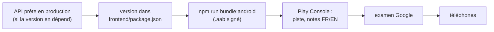

# Publier l'application Android

L'application Android est le frontend embarqué avec Capacitor (ADR 0012), package `lu.architech.countrep`, publiée sur
Google Play. Elle appelle l'API de production, `https://countrep.architech.lu`. Sa version est celle de
`frontend/package.json`, indépendante des tags `web-v*` ([pourquoi](../explanation/versions-and-releases.md)).



## La première fois (prérequis)

1. **Android Studio** installé, avec le SDK 36 ([Lancer l'application sur un téléphone
   Android](run-on-an-android-phone.md)).
2. **La clé d'importation** et `~/.gradle/gradle.properties` ([Créer la clé d'importation](create-the-upload-key.md)).
   Sans elle, le build release n'est pas signé et la Play Console le refuse.
3. **Connexion Google depuis l'application du Store** : un client OAuth Android pour la **clé Google Play** (et un pour
   la clé d'importation) dans Google Cloud, déjà créés ([Configurer la connexion Google](set-up-google-sign-in.md), [Signature
   Android](../reference/android-signing.md)). Sans lui, la connexion échoue avec `[28444] Developer console is not set
   up correctly` dans l'application installée depuis le Store, alors qu'elle marche en local.
4. **Fiche et déclarations de la Play Console** (Règles et programmes › Contenu de l'application ; Développer sa
   présence › Présence sur le Store › Fiche principale ; les libellés de la console changent parfois) :
   - Politique de confidentialité : `https://sport.architech.lu/countrep/privacy.html` (dépôt `architech-sport`) ;
   - Suppression du compte : `https://sport.architech.lu/countrep/delete-account.html` (ADR 0016) ;
   - Sécurité des données : identifiant Google (`sub`) et prénom, saisies et séances ; chiffrées en transit ;
     suppression sur demande, dans l'application et sur la page web ; pas de partage, pas de publicité ;
   - Accès à l'application : aucune connexion requise, tout fonctionne sans compte (ADR 0014) ;
   - Fiche : icône `icons/playstore-icon.png` (512 × 512), captures `docs/screenshots/fr/` et `docs/screenshots/en/`,
     descriptions en français et en anglais.

## Où on en est (2026-11-02)

- Compte développeur **personnel** `mauvaisetroupe`. Production **inactive** ; la version `1.0.1` (10001) est en
  **test fermé « Alpha »** (4 pays) et en **test interne**.
- Toutes les déclarations du contenu de l'application sont faites (2026-10-22).
- **Pour passer en production**, un compte personnel doit d'abord faire tourner un test fermé avec **au moins
  12 testeurs inscrits pendant 14 jours** (1 inscrit aujourd'hui), puis demander l'accès (Tableau de bord › Apply for
  production, avec un questionnaire sur le test).
- **Connexion Google** : le projet Google Cloud est en mode **Test**. Chaque testeur qui veut se connecter doit aussi
  être utilisateur de test dans Google Cloud ; avant la production, publier l'écran de consentement ([Configurer la
  connexion Google](set-up-google-sign-in.md#ajouter-un-utilisateur)).

## À chaque version

### 1. Vérifier l'ordre

Si la version utilise une route ou un champ nouveau de l'API, [publier la version web](release-the-web-app.md) et la
déployer **d'abord**. Les déclarations de la Play Console (Sécurité des données) et la politique de confidentialité
se mettent à jour **avant** l'envoi si les données collectées changent : l'examinateur les lit.

### 2. Monter la version

Dans `frontend/package.json`, `version` (par exemple `1.0.1` → `1.0.2`), avec le même sens qu'ailleurs : correctif,
ajout, rupture. C'est la seule source : Gradle en déduit `versionName` (`1.0.2`) et `versionCode`
(`majeur * 10000 + mineur * 100 + correctif`, ici `10002`). Google Play refuse un `versionCode` déjà envoyé : **monter
la version à chaque envoi**, même pour un essai en test interne.

```bash
cd frontend
npm version patch --no-git-tag-version     # ou minor, major ; modifie package.json et package-lock.json
```

Commiter ce changement (`chore(android): 1.0.2`). Un tag git n'est pas nécessaire : la Play Console garde l'historique ;
pour le retrouver dans git, `git log -p -- frontend/package.json`.

### 3. Construire

```bash
cd frontend
npm run bundle:android
```

Fait `vue-tsc`, `vite build --mode android` (`.env.android` : l'API de production, pas de PWA), `cap sync android`,
puis `./gradlew bundleRelease`. Le fichier à envoyer :

```
frontend/android/app/build/outputs/bundle/release/app-release.aab
```

Vérifier la signature et la version avant l'envoi :

```bash
keytool -printcert -jarfile android/app/build/outputs/bundle/release/app-release.aab | grep SHA1   # 51:68:17:13:…
```

Gradle introuvable ou mauvaise version de Java : `export JAVA_HOME="/Applications/Android Studio.app/Contents/jbr/Contents/Home"`.

Essayer la version release sur un téléphone avant de l'envoyer : [Lancer l'application sur un téléphone
Android](run-on-an-android-phone.md#essayer-le-build-release).

### 4. Envoyer dans la Play Console

[play.google.com/console](https://play.google.com/console) › CountRep › **Tester et publier** :

1. Choisir la piste : **Test interne** (immédiat, testeurs listés), **Test fermé** (« Alpha », celle des testeurs
   inscrits), ou **Production**.
2. **Créer une release** › Importer `app-release.aab`.
3. **Notes de version**, en français et en anglais, dans le format demandé :

   ```
   <fr-FR>
   Corrections et améliorations.
   </fr-FR>
   <en-US>
   Fixes and improvements.
   </en-US>
   ```

4. Suivant › relire les avertissements (un avertissement sur les symboles de débogage ou l'obscurcissement est
   attendu : `minifyEnabled false`) › **Enregistrer et publier** (ou « Envoyer pour examen »).
5. Vue d'ensemble de la publication : suivre l'examen (de quelques heures à quelques jours).

Pour passer une release d'une piste à l'autre sans reconstruire : sur la piste, **Promouvoir la release**.

### 5. Vérifier

Une fois publiée, installer ou mettre à jour depuis le Play Store, puis : la version en bas des Réglages, une saisie
sans compte, la connexion Google, la synchronisation.

## Si ça ne va pas

| Symptôme | Cause probable |
|---|---|
| « Le code de version X a déjà été utilisé » | Version de `package.json` pas montée |
| « Votre Android App Bundle est signé avec la mauvaise clé » | Mauvais keystore dans `gradle.properties` ; ou clé perdue : la remplacer ([Signature Android](../reference/android-signing.md)) |
| Build release non signé (avertissement Gradle) | `COUNTREP_UPLOAD_STORE_FILE` absent de `~/.gradle/gradle.properties` |
| Connexion Google : `[28444] Developer console is not set up correctly` | Client OAuth Android manquant pour la clé qui signe (Google Play pour l'application du Store) |
| L'application ne synchronise plus après un déploiement web | L'API n'est plus compatible avec cette version : corriger l'API, pas l'application |

Il n'y a pas de retour en arrière sur Google Play : publier une nouvelle version avec un `versionCode` plus grand.
