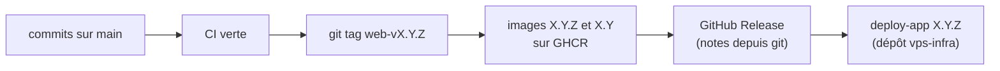

# Publier une version web

La « version web », c'est l'image `countrep` (l'API et le site, PWA comprise) et l'image `countrep-migrations`,
toujours au même numéro. Elle se publie par un tag git `web-vX.Y.Z` ; l'application Android a sa propre version
([pourquoi](../explanation/versions-and-releases.md)).



## 1. Préparer

- **Compatibilité** : l'API doit accepter le frontend précédent (PWA pas encore mise à jour) **et l'application
  Android déjà installée**, qui ne change qu'avec le Store. Ne jamais retirer ni renommer un champ ou une route utilisés
  par une version encore en circulation.
- **Action de l'exploitant** (variable ajoutée, version de PostgreSQL, migration sans retour en arrière) : le commit
  qui la provoque est marqué `!` et dit quoi faire, par exemple :

  ```
  feat(auth)!: add SESSION_DAYS

  BREAKING CHANGE: set SESSION_DAYS in the .env of the host (default 7)
  ```

  Ces commits remontent dans « À lire avant de déployer » des notes de version. Une variable ajoutée se décrit aussi
  dans [`exploitation.md`](../exploitation.md), dans le même commit ([Ajouter une variable de
  configuration](add-a-configuration-variable.md)).
- **Migration** : jamais de modification d'une migration publiée. La CI refuse de créer la release sinon.

## 2. Choisir le numéro

Version précédente : `git describe --tags --abbrev=0 --match 'web-v*'`.

| Changement | Exemple depuis `1.0.1` |
|---|---|
| Correctif seulement | `1.0.2` |
| Ajout compatible (fonction, migration compatible) | `1.1.0` |
| Action de l'exploitant ou migration sans retour en arrière | `2.0.0` |

## 3. Publier

```bash
git switch main && git pull
git push                                   # si des commits locaux restent
```

Attendre la CI verte sur ce commit (onglet Actions, ou `gh run watch`). Puis :

```bash
git tag web-v1.0.2
git push origin web-v1.0.2
```

La CI (`.github/workflows/ci.yml`, [détail](../reference/ci.md)) refait le build, publie les deux images sous `1.0.2`
et `1.0` sur `ghcr.io/mauvaisetroupe/`, puis crée la GitHub Release « CountRep web 1.0.2 ».

Vérifier :

```bash
gh run watch                                               # jusqu'au bout, jobs images et release compris
gh release view web-v1.0.2                                  # les notes
docker manifest inspect ghcr.io/mauvaisetroupe/countrep:1.0.2 > /dev/null && echo ok
```

Relire les notes : « À lire avant de déployer » doit contenir ce qu'on attend, et seulement ça.

**Tag posé par erreur, avant la fin de la CI** : `git push origin :refs/tags/web-v1.0.2 && git tag -d web-v1.0.2`,
supprimer la release si elle existe (`gh release delete web-v1.0.2`), puis recommencer. Une image déjà publiée
sous `1.0.2` sera écrasée par la suivante : ne pas le faire si elle a été déployée, prendre plutôt `1.0.3`.

## 4. Déployer en production

La production tourne sur le VPS, exploitée depuis le dépôt **`vps-infra`** (`../vps-infra`), qui a sa propre
documentation : [`apps/countrep/README.md`](https://github.com/mauvaisetroupe/vps-infra/blob/main/apps/countrep/README.md)
et le guide « Déployer une version » (`docs/how-to/deploy-a-version.md`). En résumé, depuis le Mac :

```bash
ssh -t vps-ovh sudo -iu countrep grep VERSION app/.env       # la version en service
ssh -t vps-ovh sudo -iu countrep deploy-app 1.0.2
```

`deploy-app` télécharge les images, arrête l'application, sauvegarde la base, applique les migrations, redémarre et
attend la santé ; en cas d'échec, il relance la version précédente. Il finit par `app 1.0.2 in service (before: …)`.

Si les notes demandent une action (variable…), la faire **avant** `deploy-app` : `.env.example` et `compose.yml` dans
`vps-infra/apps/countrep/`, playbook, puis `.env` du host (voir le guide de `vps-infra`).

## 5. Vérifier

```bash
curl -s https://countrep.architech.lu/api/health/db           # {"status":"ok",…}
```

Puis dans le navigateur : `https://countrep.architech.lu`, accepter l'invite de mise à jour, le bas des Réglages
montre le commit ; une saisie se synchronise. Enfin, sur le téléphone, l'application Android **déjà installée** se
synchronise encore.

**Revenir en arrière** : `deploy-app <version précédente>`, ou restauration si la migration n'est pas compatible
([exploitation, Revenir en arrière](../exploitation.md#revenir-en-arrière), et le guide de `vps-infra`).
